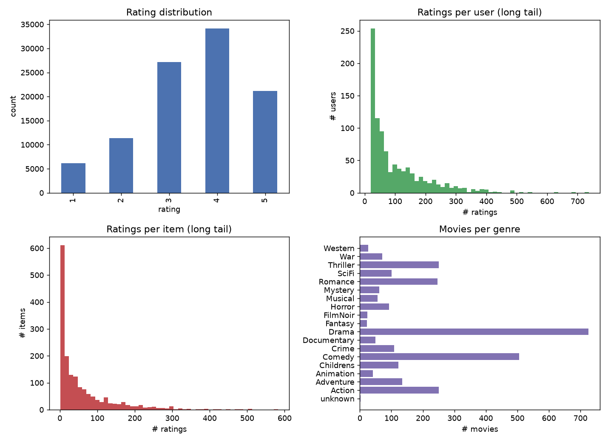
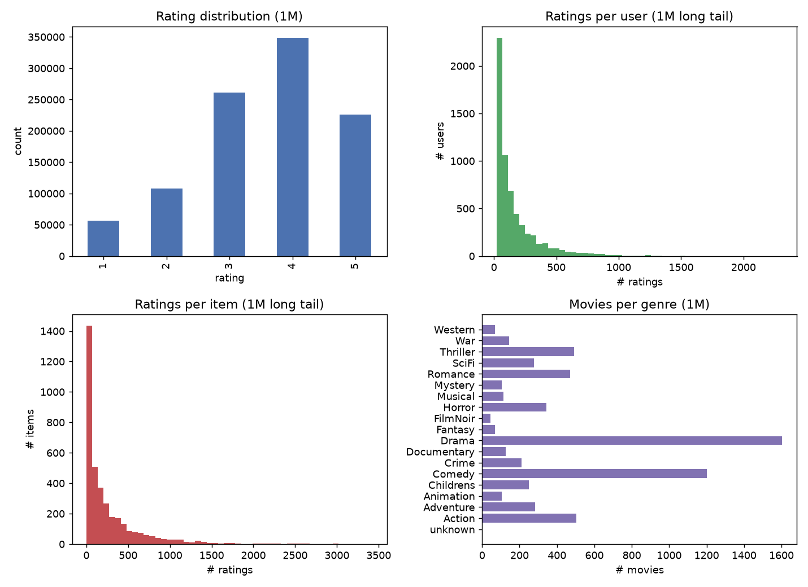

# Hybrid Movie Recommendation System (Team 5)

> A personalized hybrid recommendation system that dynamically adjusts model weights based on individual user rating counts ($N$) to address cold-start and data sparsity issues.

---

## 1. Project Overview

* **Course**: Machine Learning Term Project
* **Objective**: Overcome rating sparsity and cold-start limitations in movie recommendation by combining content metadata and latent factor modeling.
* **Core Strategy**:
  * **Light Users** (low $N$): Prioritize **Content-Based Filtering (TF-IDF)** using item metadata (genres, titles).
  * **Heavy Users** (high $N$): Prioritize **Model-Based Collaborative Filtering (SVD / MF)** to exploit learned latent factors.
  * **Dual Scale Verification**: Rapid prototyping with **MovieLens 100k** followed by scale-up validation on **MovieLens 1M**.

---

## 2. Team Members & Responsibilities

| Student ID | Name | Role | Responsibilities & Code |
| :--- | :--- | :--- | :--- |
| **202334556** | **Hoseong Chu** | Pipeline & Evaluation | Hybrid assembly, evaluation, project coordination (`main.py`) |
| **202239866** | **Wonjun Kim** | Data Preprocessing | Data exploration (EDA), cleaning, and train/test split (`preprocess.py`, `preprocess_1m.py`) |
| **202135594** | **Jeonghyeok Han** | Content-Based Model | Metadata feature extraction and TF-IDF recommender (`models/content_based.py`) |
| **202235149** | **Gyeonghoe Heo** | Model-Based CF | Latent factor modeling using SVD / Matrix Factorization (`models/model_based.py`) |

---

## 📊 3. Datasets

* **Source**: [MovieLens Datasets](https://grouplens.org/datasets/movielens/)
* **MovieLens 100k (Prototyping)**:
  * `u.data`: 100,000 ratings from 943 users across 1,682 movies.
  * `u.item`: Movie titles, release dates, and 19 genre binary flags.
  * `u.user`: User demographic information.
* **MovieLens 1M (Scale-up Validation)**:
  * `ratings.dat`: 1,000,209 ratings from 6,040 users across 3,900 movies (`::` separated).
  * `movies.dat`: Movie titles and pipe-separated genres (`Action|Adventure|...`).
  * `users.dat`: User demographics (`Gender::Age::Occupation::Zip`).

---

## 4. System Workflow

```
User Data
    │
    ├─► [Content-Based (TF-IDF)] ─────────┐
    │                                     ▼
    ├─► [Rating Count (N)] ───────► [Hybrid Assemble] ──► Top-K Recommendations
    │                                     ▲
    └─► [Model-Based CF (SVD)] ───────────┘
```

* **Score Formula**:
  $$\text{Score}(u, i) = w_{\text{CB}}(N_u) \cdot \widehat{R}_{\text{CB}}(u, i) + w_{\text{CF}}(N_u) \cdot \widehat{R}_{\text{CF}}(u, i)$$
  *(Scores are normalized before assembly to align output scales.)*

---

## 5. Project Structure

```
term_project/
├── data/
│   ├── raw/                 # Raw MovieLens 100k files
│   ├── preprocessed/        # Cleaned 100k datasets
│   ├── preprocessed_1m/     # Cleaned 1M datasets
│   ├── preprocessing.py     # 100k preprocessing pipeline
│   └── preprocessing_1m.py  # 1M preprocessing pipeline
├── ml-1m/                   # Raw MovieLens 1M files (ratings.dat, movies.dat, etc.)
├── models/
│   ├── content_based.py     # Content-based recommendation module (TF-IDF)
│   └── model_based.py       # Collaborative filtering module (SVD / MF)
├── plots/
│   ├── eda_overview.png     # 100k EDA distribution plots
│   └── eda_overview_1m.png  # 1M EDA distribution plots
├── preprocess.py            # Root runner for 100k
├── preprocess_1m.py         # Root runner for 1M
├── main.py                  # End-to-end execution and hybrid evaluation
├── .gitignore
└── README.md
```

---

## 🔬 6. Data Preprocessing & EDA Details

### [1] Dataset Comparison & EDA Summary

| Metric | MovieLens 100k (Prototyping) | MovieLens 1M (Scaling) | Preprocessing Insight |
| :--- | :--- | :--- | :--- |
| **Total Ratings** | 100,000 | **1,000,209** | 10x scale-up validation |
| **Users** | 943 | **6,040** | User base expansion (6.4x) |
| **Movies (Items)** | 1,682 | **3,883** (3,706 rated) | Catalog expansion (2.3x) |
| **Matrix Sparsity** | 93.7% | **95.53%** | Sparsity worsens, reinforcing need for hybrid approach |
| **Overall Mean Rating** | 3.53 | **3.582** | Consistent global rating behavior |
| **Train Global Mean** | 3.5292 | **3.5823** | Leakage-free baseline rating |
| **User Rating Range** | 20 ~ 737 (median 65) | 20 ~ 2,314 (median 96) | Extreme long-tail imbalance in both datasets |
| **Cold Item ($\le 5$ ratings)** | 22.8% | 8.9% | Significant unrated/rare movie proportion |




### [2] Quality Checks & Deterministic Reproducibility
- **Data Cleaning**: 0 missing ratings, duplicates resolved by retaining the latest timestamp.
- **Deterministic Multi-key Sorting**:
  - Addressed environment-dependent split differences caused by identical timestamps across different OS/NumPy versions.
  - Multi-key tie-breaking on `["timestamp", "user_id", "item_id"]` guarantees **100% reproducible splits** across all team members.
- **Continuous Re-indexing**:
  - Re-indexed raw IDs to contiguous $0 \dots N-1$ integers (`id_maps.json`) for sparse matrix and embedding vectorization.
- **19-Genre Schema Alignment**:
  - Both 100k and 1M schemas are aligned to 19 identical genre columns (including `unknown`) to prevent KeyError in modeling pipelines.

### [3] Train / Val / Test Split & Leakage Prevention
- **User-stratified Split (7 : 1 : 2)**:
  - **100k**: Train 70,012 / Val 9,988 / Test 20,000 (Test cold items: 0.18%).
  - **1M**: Train 700,243 / Val 99,950 / Test 200,016 (Test cold items: **0.03%**).
- **Leakage Prevention**: All normalization statistics (global mean, user/item means, user counts $N$) are computed **strictly on Train splits** (`train_stats.npz`).

### [4] Preprocessed Artifacts Specification

The exact same artifact schema is produced for both datasets (`data/preprocessed/` and `data/preprocessed_1m/`):

| File | Description | Target Module |
| :--- | :--- | :--- |
| `train.csv`, `val.csv`, `test.csv` | Split rating data (`u`, `i`, `rating`, `timestamp`) | Common / All Models |
| `train_given{3, 5, 10, 20}.csv` | **Cold-Start simulation sets** (max $k$ ratings per user) | Hybrid weighting evaluation |
| `items.csv`, `users.csv` | Re-indexed metadata tables (19 aligned genre columns) | Feature engineering |
| `item_tfidf.npz` | Genre (3x weight) + Decade + Title TF-IDF sparse matrix | `models/content_based.py` |
| `item_item_cosine.npy` | Precomputed cosine similarity matrix (float32) | `models/content_based.py` |
| `R_train.npz` | Train rating sparse CSR matrix | `models/model_based.py` |
| `train_stats.npz` | Global mean, user/item means, and **user rating counts ($N$)** | Normalization & Hybrid assemble |
| `id_maps.json` | Mapping dictionary between raw IDs and 0-based indices | ID recovery |
| `summary.json` | Dataset statistics and verification diagnostics | Evaluation & reporting |

---

## 🚀 7. Getting Started

### 1) Run Preprocessing (100k)
```bash
python preprocess.py
# or
python data/preprocessing.py
```

### 2) Run Preprocessing (1M Scale-Up)
```bash
python preprocess_1m.py
# or
python data/preprocessing_1m.py
```

### 3) Run Models & Hybrid Recommender
```bash
python main.py
```
